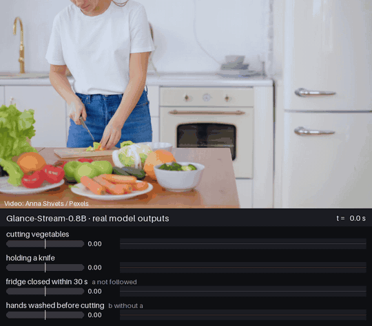

# Glance-Stream

**Standing rules over a live video stream: one 0.8B model checks all your yes/no rules together every half second
(16 per stream in our evaluation), including rules about what happened before, and boxes the person a rule is about.**

[](LICENSE)
[](https://huggingface.co/Vision-Decision/Glance-Stream-0.8B)
[](https://huggingface.co/Vision-Decision/Glance-Stream-0.8B)

[中文](README.zh-CN.md) · [Quick start](#quick-start) · [Rules](#rules) · [Results](#results) ·
[Limitations](#limitations) · [Hugging Face weights](https://huggingface.co/Vision-Decision/Glance-Stream-0.8B) ·
[Changelog](CHANGELOG.md)

You attach rules to a 30 fps video: "is someone cutting vegetables right now", "whenever the fridge is opened it must be
closed within 30 seconds", "cutting is only allowed if hands were washed in the minute before". Every 0.5 s Glance-Stream
answers all of them at once, each as p(yes) for "is this rule violated right now", from one shared state of the stream.
An alert fires after two consecutive readouts above the rule's threshold. A rule can also carry a person description;
then you get that person's box in the current frame.

Instead of a detector plus a hand-written state machine, or one model call per rule, every rule is a short question
forked from one shared state of the stream, and rules about the past are answered by the model itself. On 22 unseen
EPIC-KITCHENS streams, training on such rules cut false alarms on them from 289.9 to 173.4 per rule-hour at the same
target recall. It is a non-commercial research prototype for indoor scenes, not an alert-free monitor.



<sub>Glance-Stream-0.8B watching a 36 s kitchen clip at 30 fps with four rules (real model outputs, rendered by
[`examples/make_demo.py`](examples/make_demo.py); the raw readouts are in
[`assets/demo_predictions.json`](assets/demo_predictions.json)). Bars show p(yes) with the 0.5 threshold, the strips
show its history, red triangles are alerts. No hand-washing happens in the clip, so every cutting segment violates the
last rule. One alert is wrong: "holding a knife" fires at 11.5 s, just after the knife was put down. Footage: Anna Shvets / Pexels. Also as [MP4](assets/demo.mp4).</sub>

## Quick start

```bash
pip install "glance-stream @ git+https://github.com/Vision-Decision/Glance-Stream"
# optional, CUDA only: fast Gated-DeltaNet kernels
pip install flash-linear-attention
```

```python
from glance_stream import GlanceStream, Rule

gs = GlanceStream.from_pretrained("Vision-Decision/Glance-Stream-0.8B")   # CUDA if available, else CPU
mon = gs.monitor([
    Rule.now("someone is cutting vegetables"),
    Rule.must_follow("someone opens the fridge", "someone closes the fridge", within=30),
    Rule.now("someone is holding a knife", box="the woman holding a knife"),
])
def on_readout(r):                                  # called every 0.5 s of video, as the stream is processed
    for name in r.alerts:
        print(f"{r.t:.1f}s ALERT {name} p={r.p[name]:.2f}", r.boxes.get(name))

readouts = mon.run("kitchen.mp4", fps=30, callback=on_readout)   # all readouts, also returned at the end
```

The first call downloads Qwen3.5-0.8B (about 1.7 GB) and the Glance-Stream adapters and box head (about 100 MB).

On your own video, from the command line:

```bash
python examples/run_rules.py my_video.mp4                                     # the three rules above
python examples/run_rules.py my_video.mp4 --rules examples/kitchen_rules.json --out readouts.json
python examples/run_rules.py my_video.mp4 --rule "Is someone on the phone right now?"
python examples/make_demo.py my_video.mp4 readouts.json --out my_demo      # my_demo.mp4 / my_demo.gif
```

## How it works

| Part | What it does |
|---|---|
| Stream | each frame group (two consecutive frames through the Qwen3.5 vision tower's 2-frame tubelet, 64 tokens at 256×256, plus a text timestamp every 0.5 s) is written once into the model's state |
| Memory | the Gated-DeltaNet layers (3 of every 4) carry their recurrent state through the whole video; the full-attention layers keep a bounded window: every group of the last 4 s, older groups up to 600 s on a 2 s grid (about 30k tokens); positions are re-based so hour-long streams stay in the trained range |
| Rules | every rule is a short question block forked from the current state, answered, and discarded: nothing is written back, so rules never affect each other or the stream; all rules of a readout are one batched forward |
| Answer | p(yes) from the first answer token, restricted to the yes/no tokens; no text is generated |
| Boxes | a latent token after the box question is read at the last layer; a choice over the newest frame's 64 patches, four ordinal edge distributions and an IoU head give the box, a presence head says whether the person is there |
| Adapters | two LoRA adapters (rules, boxes) act only on question tokens; the video path runs the unchanged Qwen3.5-0.8B, so the two cannot interact: on a test clip the released model's rule answers are bit-identical to the rule checkpoint alone and its boxes to the box checkpoint alone |

Cross-time rules are answered **end to end** from the stream state: there is no event detector or state machine at
inference time. The model was trained on the six rule types below with labels computed by a rule engine from human
event annotations.

## Rules

| Type | Constructor | Violated when | Template asked |
|---|---|---|---|
| `now` | `Rule.now(X)` | X is happening | `Is this happening right now: X?` |
| `after_then` | `Rule.after(A, forbidden=B)` | B happens after A has happened once | `Rule: after 'A' has happened, 'B' is not allowed. …` |
| `b_without_a` | `Rule.requires_before(B, A, within=T)` | B starts with no A in the T s before | `Rule: 'B' is only allowed if 'A' happened in the T seconds before it. …` |
| `a_not_followed` | `Rule.must_follow(A, B, within=T)` | A happened and no B within T s (from the deadline until B) | `Rule: whenever 'A' happens, 'B' must follow within T seconds. …` |
| `count_in_window` | `Rule.at_most(X, times=n, within=T)` | X started more than n times in the last T s | `Rule: 'X' may happen at most n times in any T seconds. …` |
| `while_state` | `Rule.forbidden_between(A, C, B)` | B happens between an A and the next C | `Rule: between 'A' and the next 'C', 'B' is not allowed. …` |
| `custom` | `Rule.custom(text)` | your own yes/no question | your text |

Every cross-time template ends with "Is the rule being violated right now?", and every question gets " Answer yes or no." appended. Write events as short present-tense
phrases ("someone opens the fridge"). Each rule also takes `name`, `threshold` (default 0.5), `k` (consecutive readouts
before an alert, default 2), `cooldown_s` (default 5) and `box` (a person description, see below).

```python
from glance_stream import GlanceStream, Rule, violations

gs = GlanceStream.from_pretrained("Vision-Decision/Glance-Stream-0.8B")
rules = [
    Rule.after("someone opens the fridge", "someone is cutting vegetables", name="no cutting after the fridge"),
    Rule.at_most("someone opens the fridge", times=3, within=120),
    Rule.forbidden_between("someone turns on the stove", "someone turns off the stove", "someone leaves the kitchen"),
    Rule.custom("Is a pan smoking?", threshold=0.7),
]
mon = gs.monitor(rules, every=0.5)
readouts = mon.run("kitchen.mp4", fps=30, start=60, end=180)
r = readouts[-1]
r.t, r.p, r.on, r.alerts          # time, p(yes) per rule, p >= threshold per rule, rules alerting at this readout

# Live sources: feed decoded frames yourself, a torch uint8 tensor (T, 3, 256, 256) and their times (s) on a k/fps grid
mon.reset()
new_readouts = mon.feed(frames, times, fps=30)

# Ground truth for your own annotated video, to pick thresholds: violation intervals from timestamped events
violations(rules[0], [("someone opens the fridge", 3.0, 5.0), ("someone is cutting vegetables", 9.0, 20.0)], t_end=30)
# [[9.0, 20.0]]
```

**Boxes.** `Rule.now("someone is holding a knife", box="the woman holding a knife")` asks, at every readout, *Where is
the person described as "the woman holding a knife" right now?* and returns `r.boxes[name]` with normalised corners
`xyxy`, `presence` (P(the person is in the frame)) and `confidence` (predicted P(IoU ≥ 0.5)); `box.pixels(w, h)`
converts to pixels. The box head was trained on person descriptions; describe the person, not the object.

## Installation

Requires Python ≥ 3.11, PyTorch ≥ 2.4, transformers ≥ 5.23 (Qwen3.5) and PyAV.

```bash
pip install "glance-stream @ git+https://github.com/Vision-Decision/Glance-Stream"
# or from a clone
git clone https://github.com/Vision-Decision/Glance-Stream && cd Glance-Stream && pip install -e ".[demo,test]"
python -m pytest tests                                      # rule engine and wording, CPU only
```

| Device | Precision | Notes |
|---|---|---|
| CUDA | bf16 base, fp32 adapters | install `flash-linear-attention` for the fast recurrent kernel; without it transformers uses its PyTorch reference |
| CPU | fp32 | works, far from real time |

`examples/make_demo.py` also needs `ffmpeg` on PATH.

Two engines run the same model ([docs/ENGINE.md](docs/ENGINE.md)): `engine="reference"` (default, the one every
accuracy number was measured with) and `engine="fused"` (one fused forward per frame, CUDA and Triton 3.8 only; not
bit-identical to the reference; on an earlier 0.8B checkpoint it did not pass its fixed equivalence criterion, a re-test
is pending, and the released weights have not been compared across engines).

## Results

Only final results are listed; protocols in [docs/EVALUATION.md](docs/EVALUATION.md).

| What | Data | Result |
|---|---|---|
| False alarms per rule-hour on cross-time rules, at 80% event recall | 22 EPIC-KITCHENS-100 streams from 10 participants, never trained on | **289.9 → 173.4** against the same recipe without rule training (p = 0.002 over participants) |
| Box Acc@0.5 (person descriptions) | HC-STVG v2 test, 267 clips, 2 fps | **48.5** |
| Latency per frame, fused engine: write + 8 rules + 1 box, 30 fps arrivals | RTX PRO 6000, one stream, ~30k-token window | **P50 23.0 ms, P99 24.3 ms** |

At the same target recall, rule training cuts false alarms on rules that depend on what happened before by 40%. The
absolute level is still high: this is a research prototype, not an alert-free monitor. Thresholds were chosen for 80% event recall on held-out
participants; alerts need 2 consecutive readouts and have a 5 s cooldown. The accuracy numbers come from the default
reference engine; the latency comes from the fused engine, measured with shape-matched stand-in weights (latency does
not depend on the weight values).

## Limitations

- **Count rules fire too often.** "At most N times in T seconds" rules over-count: the model reports the limit as
  exceeded more often than it is.
- **"A must be followed by B within T s" is not reliable.** On the benchmark this rule type was not significantly better
  than chance at ranking readouts. The model learned not to fire when A never happened, but it does not reliably tell
  "B already came" from "B has not come yet". The fridge rule in the demo stays quiet, which is correct for that clip,
  but do not rely on this rule type.
- **Not shown to be as good as the baseline on simple rules.** On a separate benchmark of "is X happening now" rules
  (48 ten-minute streams), the rule-trained model's false alarms are on par with the baseline, but the test could not
  establish that it is no worse within a 10% non-inferiority margin fixed before the test.
- **Thresholds are not tuned for you.** 0.5 is a starting point and probabilities for cross-time rules are not
  calibrated. Pick thresholds per rule on annotated footage of your own (`violations` computes the ground truth).
- **Boxes are for people**, trained and tested on person descriptions at 2 fps, read from a 256×256 frame. Object boxes
  are untested.
- **Domain.** Trained on indoor home clips (Charades), evaluated on kitchens. Only the template wording was evaluated;
  Chinese and free-form rules appeared in training but were not evaluated.
- **0.8B only**, and no timestamps or counts as answers in this release (yes/no and boxes only).

## Repository

| Path | What |
|---|---|
| `glance_stream/api.py` | `GlanceStream`, `Monitor`, `Readout`, `Box` |
| `glance_stream/rules.py` | rule types and wording, alert trigger, reference rule engine (`violations`) |
| `glance_stream/model/` | reference streaming engine (`stream.py`), attention without boolean masks, LoRA, box head |
| `glance_stream/engine/` | fused single-pass engine (CUDA, Triton) |
| `glance_stream/video.py` | decoding at a fixed fps, tubelet pairs |
| `examples/` | `run_rules.py` (your video), `make_demo.py` (render), `kitchen_rules.json` |
| `docs/` | [EVALUATION.md](docs/EVALUATION.md), [ENGINE.md](docs/ENGINE.md), [DATA.md](docs/DATA.md) |

## License

- **Code**: [Apache-2.0](LICENSE).
- **Weights** ([Vision-Decision/Glance-Stream-0.8B](https://huggingface.co/Vision-Decision/Glance-Stream-0.8B)):
  **CC BY-NC 4.0, non-commercial use only.** The training data includes non-commercial and research-only sources; see
  [docs/DATA.md](docs/DATA.md).
- **Base model** [Qwen/Qwen3.5-0.8B](https://huggingface.co/Qwen/Qwen3.5-0.8B): Apache-2.0, downloaded from its own
  repository.
- **Demo footage**: [Woman Chopping Bell Pepper](https://www.pexels.com/video/woman-chopping-bell-pepper-6617422/) by
  Anna Shvets, [Pexels License](https://www.pexels.com/license/); only the rendered demo is included.

## Citation

```bibtex
@misc{glancestream2026,
  title  = {Glance-Stream: Standing Rules over a Live Video Stream},
  author = {Vision-Decision},
  year   = {2026},
  url    = {https://github.com/Vision-Decision/Glance-Stream},
  note   = {Glance-Stream-0.8B, https://huggingface.co/Vision-Decision/Glance-Stream-0.8B}
}
```

## Acknowledgements

- The [Qwen](https://huggingface.co/Qwen) team for Qwen3.5-0.8B, and Hugging Face `transformers`.
- [flash-linear-attention](https://github.com/fla-org/flash-linear-attention) for the Gated-DeltaNet kernels.
- The authors of Charades, Charades-STA, RepCount-A, HC-STVG and EPIC-KITCHENS-100.
- Anna Shvets for the demo footage.
