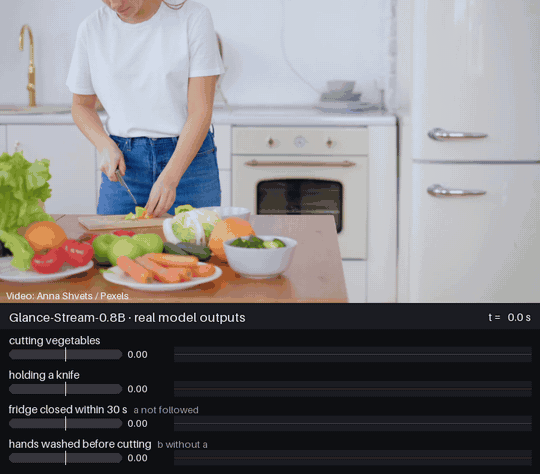

# Glance-Stream

**给实时视频流挂上一组常驻规则：一个 0.8B 模型每半秒把所有是非规则一起判断一遍（评测中每条流 16 条），包括"之前发生过什么"这类跨时间的规则，需要时还给出规则所指那个人的框。**

[English](README.md) · [快速开始](#快速开始) · [规则](#规则) · [结果](#结果) · [已知局限](#已知局限) ·
[Hugging Face 权重](https://huggingface.co/Vision-Decision/Glance-Stream-0.8B) · [更新日志](CHANGELOG.md)

你给一段 30 fps 的视频挂上若干规则，例如：

- "现在有人在切菜吗"；
- "冰箱打开后 30 秒内必须关上"；
- "切菜前一分钟内必须洗过手"。

Glance-Stream 每 0.5 秒对所有规则同时给出一次判断。每条规则得到的是"此刻规则是否被违反"的 p(yes)，全部来自同一份流状态。连续两次读出超过阈值就触发报警。规则还可以带一段人物描述，这时会同时返回这个人在当前帧里的框。

它不是"检测器 + 手写状态机"，也不是每条规则调用一次模型：每条规则都是从同一份流状态分叉出的短问题，跨时间规则由模型自己回答。在 22 条未见过的 EPIC-KITCHENS 长流上，经过这类规则训练后，跨时间规则的误报在相同目标召回下从每规则·小时 289.9 次降到 173.4 次。它是面向室内场景的非商用研究原型，误报仍然不少。



<sub>Glance-Stream-0.8B 以 30 fps 观看一段 36 秒的厨房视频，同时挂四条规则。画面是真实模型输出，由 [`examples/make_demo.py`](examples/make_demo.py) 渲染，原始读出在 [`assets/demo_predictions.json`](assets/demo_predictions.json)。条形是 p(yes)，竖线是 0.5 阈值；右侧曲线是历史；红色三角是报警。片中没有洗手，所以每段切菜都违反最后一条规则。有一次报警是错的：11.5 秒刚放下刀时，"holding a knife" 仍然报警。素材：Anna Shvets / Pexels（[Pexels License](https://www.pexels.com/license/)）。另有 [MP4](assets/demo.mp4)。</sub>

## 快速开始

```bash
pip install "glance-stream @ git+https://github.com/Vision-Decision/Glance-Stream"
pip install flash-linear-attention   # 可选，仅 CUDA：Gated-DeltaNet 快速内核
```

```python
from glance_stream import GlanceStream, Rule

gs = GlanceStream.from_pretrained("Vision-Decision/Glance-Stream-0.8B")   # 有 CUDA 用 CUDA，否则 CPU
mon = gs.monitor([
    Rule.now("someone is cutting vegetables"),
    Rule.must_follow("someone opens the fridge", "someone closes the fridge", within=30),
    Rule.now("someone is holding a knife", box="the woman holding a knife"),
])
def on_readout(r):                                  # 视频每推进 0.5 秒调用一次，边处理边输出
    for name in r.alerts:
        print(f"{r.t:.1f}s 报警 {name} p={r.p[name]:.2f}", r.boxes.get(name))

readouts = mon.run("kitchen.mp4", fps=30, callback=on_readout)   # 结束时也返回全部读出
```

首次调用会下载 Qwen3.5-0.8B（约 1.7 GB），以及 Glance-Stream 的 adapter 和框头（约 100 MB）。

在自己的视频上运行：

```bash
python examples/run_rules.py my_video.mp4                                     # 上面三条规则
python examples/run_rules.py my_video.mp4 --rules examples/kitchen_rules.json --out readouts.json
python examples/run_rules.py my_video.mp4 --rule "Is someone on the phone right now?"
python examples/make_demo.py my_video.mp4 readouts.json --out my_demo      # 生成 my_demo.mp4 / my_demo.gif
```

## 工作方式

- **写入。** 每个帧组只写入一次模型状态。一个帧组是相邻两帧经 Qwen3.5 视觉塔的 2 帧 tubelet 得到的 64 个 token（256×256），每 0.5 秒另加一个文本时间戳。
- **记忆。** Gated-DeltaNet 层（每 4 层中的 3 层）的递归状态贯穿整段视频。全注意力层只保留有界窗口：最近 4 秒的全部帧组，加上 600 秒以内每 2 秒一组，约 30k token。位置编码会周期性平移回训练范围，小时级的流也不会越界。
- **提问。** 每条规则是从当前状态分叉出的一个短问题块，答完即丢弃，不写回状态。所以规则之间互不影响，也不影响流本身。一次读出的所有规则是一次批量前向。
- **答案。** 取第一个答案 token 上 yes/no 的概率，不生成文本。
- **框。** 框问题后接一个 latent token，在最后一层读出它的隐状态。读出头在最新帧的 64 个 patch 上选一个，用四个有序边分布给出框，另有 IoU 头和存在头。
- **适配器。** 规则和框各有一个 LoRA，都只作用于问题 token。视频写入始终走未改动的 Qwen3.5-0.8B，所以两个 LoRA 互不干扰：同一段视频上，发布模型的规则概率与单独的规则检查点逐位一致，框与单独的框检查点逐位一致。

跨时间规则由模型直接从流状态**端到端**回答，推理时没有事件检测器或状态机。训练用的就是下面这六种规则类型，标签由规则引擎根据人工事件标注计算。

## 规则

| 类型 | 构造函数 | 何时算违反 |
|---|---|---|
| `now` | `Rule.now(X)` | X 正在发生 |
| `after_then` | `Rule.after(A, forbidden=B)` | A 发生过之后又出现 B |
| `b_without_a` | `Rule.requires_before(B, A, within=T)` | B 开始前 T 秒内没有 A |
| `a_not_followed` | `Rule.must_follow(A, B, within=T)` | A 之后 T 秒内没有 B（从截止时刻起，到 B 出现为止） |
| `count_in_window` | `Rule.at_most(X, times=n, within=T)` | 最近 T 秒内 X 开始了超过 n 次 |
| `while_state` | `Rule.forbidden_between(A, C, B)` | 在 A 和下一个 C 之间出现 B |
| `custom` | `Rule.custom(text)` | 你自己写的是非问题 |

事件用简短的英文现在时短语写，例如 "someone opens the fridge"。每条规则还可以设置：

- `name`：规则名；
- `threshold`：阈值，默认 0.5；
- `k`：连续几次读出过阈值才报警，默认 2；
- `cooldown_s`：报警冷却时间，默认 5 秒；
- `box`：人物描述，用于给框。

模型训练和评测用的确切措辞见 `Rule.template()`。注意 `count_in_window` 在 JSON 规则文件里的 `N` 表示"第 N 次开始即违反"，`"N": 3` 等于 `Rule.at_most(x, times=2, within=T)`。实时视频源可以用 `mon.feed(frames, times, fps)` 自己喂帧。`violations()` 能根据带时间戳的事件算出规则的违反区间，可用来在自己的标注视频上选阈值。

**框。** `Rule.now("someone is holding a knife", box="the woman holding a knife")` 会在每次读出时问 *Where is the person described as "the woman holding a knife" right now?*，结果在 `r.boxes[name]` 里：

- `xyxy`：归一化的左上、右下角坐标；
- `presence`：这个人在当前帧里的概率；
- `confidence`：预测的 IoU ≥ 0.5 的概率。

`box.pixels(w, h)` 可换算成像素坐标。框头只在人物描述上训练过，描述里写人，不要写物体。

## 安装

需要 Python ≥ 3.11、PyTorch ≥ 2.4、transformers ≥ 5.23（Qwen3.5）和 PyAV。`examples/make_demo.py` 还需要系统里有 `ffmpeg`。

```bash
git clone https://github.com/Vision-Decision/Glance-Stream && cd Glance-Stream && pip install -e ".[demo,test]"
python -m pytest tests                                      # 规则引擎和措辞，只用 CPU
```

| 设备 | 精度 | 说明 |
|---|---|---|
| CUDA | 基座 bf16，adapter fp32 | 装上 `flash-linear-attention` 可用快速递归内核 |
| CPU | fp32 | 能跑，远达不到实时 |

模型由一个流式引擎运行（见 [docs/ENGINE.md](docs/ENGINE.md)）。优化引擎在验证中，计划在后续版本发布。

## 结果

只列已有确定结果的数字，评测协议见 [docs/EVALUATION.md](docs/EVALUATION.md)。

| 指标 | 数据 | 结果 |
|---|---|---|
| 跨时间规则的误报/规则·小时（事件召回 80%） | EPIC-KITCHENS-100 的 22 条长流，来自 10 名参与者，均未参与训练 | 对照为同配方但不含规则训练：**289.9 → 173.4**（按参与者配对，p = 0.002） |
| 框 Acc@0.5（人物描述） | HC-STVG v2 测试集 267 段，2 fps | **48.5** |


## 已知局限

- **计数类规则报得偏多。** 对"T 秒内最多 N 次"这类规则，模型判"超限"的次数多于实际。
- **"A 之后 T 秒内必须有 B"不可靠。** 在评测中，这类规则的排序能力没有显著高于随机。模型学会了"没有 A 就不报"，但分不清"B 已经来了"和"B 还没来"。演示里冰箱这条规则一直没有报警，对这段视频是对的，但不要依赖这类规则。
- **简单规则上没能证明不比对照差。** 另一个"现在有没有 X"的部署评测（48 条 10 分钟流）上，误报与对照基本持平，但没能在事先设定的 10% 非劣效界值内证明不比对照差。
- **阈值需要自己调。** 0.5 只是起点。跨时间规则的概率没有校准，请在自己的标注视频上逐条规则选阈值。
- **框只针对人。** 框头只在人物描述上训练和评测过，评测为 2 fps，从 256×256 的帧上读出。给物体画框没有测过。
- **领域有限。** 训练数据是室内家居视频（Charades），评测是厨房场景。只评测过模板措辞；中文和自由措辞的规则在训练中出现过，但没有评测。
- **只有 0.8B。** 本版本只回答是非和框，不输出时间戳或计数。

## 许可

- 代码：Apache-2.0。
- 权重：**CC BY-NC 4.0，仅限非商业用途**。训练数据包含仅限非商用和仅限研究用途的来源，见 [docs/DATA.md](docs/DATA.md)。
- 基座模型 Qwen/Qwen3.5-0.8B：Apache-2.0。
- 演示素材：Anna Shvets 的 [Woman Chopping Bell Pepper](https://www.pexels.com/video/woman-chopping-bell-pepper-6617422/)，遵循 [Pexels License](https://www.pexels.com/license/)。仓库只收录渲染后的演示视频，不含原片。
